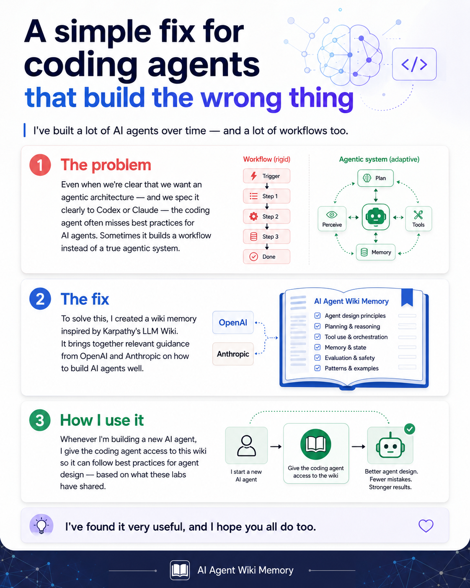

# ai-agent-wiki

A knowledge base on **building effective AI agents** — architecture choices,
tools, orchestration, context engineering, harness design, and guardrails —
synthesized from primary guidance by Anthropic and OpenAI: their engineering
and security posts, developer blogs, per-model prompting guides, and white
papers, plus vendor-published customer case studies and Cursor's coding-swarm
experiments.

It's maintained by an LLM agent ([Claude Code](https://www.anthropic.com/claude-code),
via [`CLAUDE.md`](CLAUDE.md)) and meant to be **read by both humans and other
agents** — point an agent at this repo and it can cite settled answers instead
of re-deriving them from scratch.

This repo is **two things at once**: a live knowledge base on building AI
agents, and a reusable scaffold you can fork empty to grow your own wiki on any
topic (see [Start your own](#start-your-own)).



## What's inside

The corpus is **148 source summaries · 10 entities · 23 concepts · 2 syntheses**
(as of 2026-10-13), covering how to design, build, and safely deploy LLM agents.
Coverage: Anthropic's Engineering blog, `claude.dev`, and `claude.com` articles;
OpenAI's developer blog, its openai.com Engineering and Security posts, and its
guides. [`log.md`](log.md) records what was ingested, when, and what was left
out.

- Start at [`wiki/overview.md`](wiki/overview.md) for the full thesis, or
  [`index.md`](index.md) for the catalog of every page.

**The thesis in one line:** the labs strongly agree on a few load-bearing
principles — *don't build an agent unless you need one*, *start simple and add
complexity only when evals justify it*, *tools are the highest-leverage surface*,
*instructions must be unambiguous*, *safety is layered*, *engineer the context
and harness, then prune them*, *optimize the whole system, not one model call*,
*contain at the environment layer and keep secrets out of the agent's reach*,
and *verification, not generation, is the bottleneck*. They differ mainly in
emphasis, and since late 2025 they have converged on much of the same harness
architecture independently.

### What a page looks like

Pages are dense, cross-linked (`[[wikilinks]]`), and cite their sources inline.
Excerpt from [`wiki/concepts/agents-vs-workflows.md`](wiki/concepts/agents-vs-workflows.md):

```markdown
[[anthropic]] frames a spectrum of agentic systems:
- Workflows — LLMs and tools orchestrated through predefined code paths.
  Predictable and consistent; best for well-defined tasks.
  (see [[anthropic-building-effective-agents]])
- Agents — LLMs dynamically direct their own processes and tool usage,
  controlling how they accomplish a task.
  (see [[anthropic-building-effective-agents]])
```

## Using this wiki

### As a human

- Open the folder as an [Obsidian](https://obsidian.md) vault, start at
  [`wiki/overview.md`](wiki/overview.md), and follow wikilinks / the graph view.
- Ask the maintaining agent a question (*"what do my sources say about
  multi-agent orchestration?"*) — it answers with citations and, if the answer
  is durable, files it into `wiki/synthesis/` for next time.

### As an agent

- Read [`CLAUDE.md`](CLAUDE.md) first — it's the schema and operating contract
  for this wiki. [`AGENTS.md`](AGENTS.md) is a generated copy for agents that
  look for that file name.
- Read [`index.md`](index.md) to find candidate pages before reading anything
  else; run `tools/search.py "<query>"` for what isn't obvious from the index.
- Prefer citing an existing `wiki/` page over re-deriving an answer from
  `raw/` — the synthesis and cross-references already exist.
- If you're building an agent yourself, the principles in
  [`wiki/overview.md`](wiki/overview.md) and [`wiki/concepts/`](wiki/concepts/)
  are a reasonable starting checklist: scope, tool design, orchestration,
  context engineering, guardrails.

```
python3 tools/search.py "your query"     # ranked results across wiki/
python3 tools/search.py --orphans        # pages with no inbound links
python3 tools/search.py --list           # every page with its title
python3 tools/sync_agents.py             # regenerate AGENTS.md from CLAUDE.md
```

Pure stdlib — no install step.

## How it's maintained

Three layers:

| Layer | Path | Who owns it |
|-------|------|-------------|
| **Raw sources** | `raw/` | You supply files; the agent writes condensed captures of web pages. Immutable once added. |
| **The wiki** | `wiki/` | The LLM. Summaries, entity & concept pages, synthesis. |
| **The schema** | `CLAUDE.md` (+ generated `AGENTS.md`) | Both. Conventions + workflows the LLM follows. |

Three operations:

- **Ingest** — drop a source in `raw/`, ask the agent to process it. It reads,
  summarizes, updates 10–15 entity/concept pages, refreshes the index, logs it.
- **Query** — ask questions; the agent searches the wiki, answers with
  citations, and files durable answers back into `wiki/synthesis/`.
- **Lint** — periodically ask the agent to health-check: contradictions, stale
  claims, orphans, missing pages, data gaps.

Two conventions matter for a wiki about fast-moving models:

- **Model-scoped pages.** Prompting advice is a per-model contract, so pages
  whose claims hold only for certain models carry `models:` and `as_of:`. When a
  vendor stops listing a model as current, its page is marked `status: legacy`
  and points to its replacement. Concept pages hold durable axes, never values.
- **Contradictions are recorded, not overwritten.** When sources disagree, both
  claims stay on the page with their sources and dates.

## Layout

```
raw/            # your source documents (immutable) + assets/ for images
wiki/
  overview.md   # orientation + current thesis
  sources/      # one summary page per source
  entities/     # people, orgs, products, datasets, places
  concepts/     # ideas, methods, theories
  synthesis/    # comparisons & analyses worth keeping
index.md        # content catalog, by category
log.md          # append-only timeline of ingests/queries/lints
templates/      # page templates the LLM copies from
tools/search.py # local BM25 search over the wiki (no dependencies)
CLAUDE.md       # the schema — read by the agent every session
AGENTS.md       # generated copy of CLAUDE.md (tools/sync_agents.py)
```

## Getting started

1. Add a source: drop a `.md`/`.pdf`/`.txt` into `raw/` (the
   [Obsidian Web Clipper](https://obsidian.md/clipper) is great for web articles),
   or give the agent a URL and it writes a condensed capture.
2. Tell the agent: *"ingest the new source in raw/"*.
3. Browse the result in Obsidian — follow the wikilinks and the graph view.
4. Ask questions: *"what do my sources say about X?"* — good answers get filed
   into the wiki automatically.
5. Occasionally: *"lint the wiki"*.

## Start your own

Fork this repo and clear the content, keeping the machinery:

```
git clone https://github.com/jainabhishek/ai-agent-wiki.git my-wiki
cd my-wiki
rm -rf raw/* wiki/sources/* wiki/entities/* wiki/concepts/* wiki/synthesis/*
: > log.md                                # reset the timeline
```

Keep `CLAUDE.md` (the schema), `AGENTS.md`, `templates/`, and `tools/`. Edit
`wiki/overview.md` and `index.md` to describe your new topic, then start
ingesting. The agent reads `CLAUDE.md` every session and follows it.

## License & sources

The **scaffold** — `CLAUDE.md`, `AGENTS.md`, `templates/`, `tools/`, and this README — is
released under the [MIT License](LICENSE-scaffold.md); fork and adapt it freely.

The **`raw/` directory contains captures of third-party articles** (e.g. from
Anthropic and OpenAI) made for personal research. Since 2026-10-12 the agent
writes them as condensed paraphrase with only short quotes; a few earlier
captures quote example prompts in full. Copyright remains with the respective
authors; the captures are **not** covered by the MIT License and are not
redistributed for any other use. Everything under `wiki/` is LLM-generated
summary and synthesis that cites those sources.

---

**Inspiration:** the ingest/query/lint pattern and the `raw/` → `wiki/` →
`CLAUDE.md` layering follow Andrej Karpathy's
[LLM Wiki](https://gist.github.com/karpathy/442a6bf555914893e9891c11519de94f)
gist: instead of RAG-style retrieval that re-derives knowledge on every query,
the LLM incrementally builds and maintains a persistent, interlinked markdown
wiki between you and your raw sources, so cross-references and synthesis
already exist by the time you ask.
